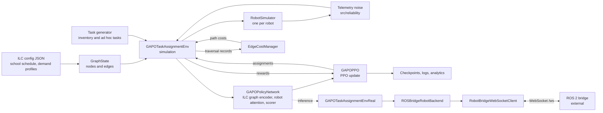

<p align="center">
  
</p>

# CareRobotics

Website: [thecarerobotics.com](https://www.thecarerobotics.com/)

CareRobotics is building the automation layer that gives hospital staff their time back. Ward nurses spend a large part of each shift searching for supplies and equipment, and missing stock delays care. CareRobotics is developing robots that restock wards, with the task-allocation software in this repository deciding which robot does which job. The company is supported by Imperial College London and UCL through the Imperial VCC Accelerator and the UCL Venture Builder. A full-size prototype is in development, and a hospital pilot is under discussion with HCA UK.

This repository holds the task-allocation and fleet orchestration software/model code for CareRobotics robots. This branch, `pilot_trial`, is configured for the inaugural pilot, aiming to replicate the replenishment logistics in a hospital in a school environment. The `main` branch is configured for tests in hospital environments, the end goal being a fully functional multi-robot system that can revolutionise patient care in hospitals, by saving clinical staff time previously attributed to laborious manual replenishment and other logistics tasks.

## Overview

A multi-agent PPO policy (GAPO) assigns restocking and pickup tasks to robots over a graph of storage, shelf and corridor nodes. Demand follows a school-day schedule. The code runs in simulation and can drive a live robot through a ROS 2 bridge.

## Architecture



## Environments

| | Hospital (`main`) | ILC pilot (`pilot_trial`) |
| --- | --- | --- |
| Config | `configs/hospital_3nodes_consumables.json` | `configs/ilc_pilot_v1_care_robotics.json` |
| Nodes | 3: 1 storage, 2 recovery | 3: 1 storage, 2 shelves |
| Demand | Consumption patterns per SKU | School-day periods with per-SKU demand profiles |
| Graph encoder | `HospitalGraphEncoder` | `ILCGraphEncoder` with school-period embedding |
| Path costs | No learned edge-cost model | Learned edge-cost model (`EdgeCostManager`) |
| Robots | Simulated, via `MockRobotBridge` | Simulated, or live through the ROS 2 bridge |

## Status

| Area | State |
| --- | --- |
| Simulation training (`run_training.py`) | Working |
| Simulation deployment (`run_deployment.py`) | Working, headless or with the pygame view |
| Real-robot training and deployment (`run_training_real.py`, `run_real_deployment.py`) | Not yet run against hardware. Requires the ROS 2 bridge. |
| Reliability layer | Phase 1 only (telemetry noise, `src/reliability/`) |

Simulation generates its own tasks and consumption from the config, so no training data is required.

## Setup

Requires Python 3.13. Dependencies are pinned in `requirements.txt`.

```bash
python -m venv .venv
.venv\Scripts\activate          # Windows (Linux/macOS: source .venv/bin/activate)
pip install -r requirements.txt
```

## Usage

Train in simulation:

```bash
python run_training.py --config configs/ilc_pilot_v1_care_robotics.json \
    --iterations 10000 --device auto --seed 42 --output-dir outputs --exp-name pilot_sim
```

Run a trained policy headless in simulation:

```bash
python run_deployment.py --config configs/ilc_pilot_v1_care_robotics.json \
    --use-trained --checkpoint outputs/pilot_sim/checkpoints/gapo_final.pth \
    --headless --max-runtime 3600
```

Drop `--headless` for the pygame view.

Run `python run_training.py --help` for the full list of training flags.

## Repository layout

```text
run_training.py              Simulation PPO training
run_deployment.py            Simulation inference, optional pygame view
run_training_real.py         Training against a live robot via the ROS 2 bridge
run_real_deployment.py       Inference against a live robot
configs/                     Pilot layout and demand configuration
src/environment/             Graph, robots, tasks and the environment
src/multi_agent_ppo/         Policy, encoders, attention, PPO, learned edge cost
src/deployment/              ROS bridge backend and WebSocket client
src/reliability/             Sim-to-real effects (telemetry noise)
src/analytics/               Realtime analytics and metrics
src/utils/                   Logging and helpers
shell/                       Cluster (Slurm) job scripts
```

## Configuration

This branch loads only pilot configs (`metadata.environment_type: ilc_open_space`). Hospital configs are in `configs/` but are rejected here. Use `main` for hospital runs.

The school day is defined in `school_schedule` (periods, operating days, and per-SKU demand profiles). Demand scales with each node's `foot_traffic_weight`.

## Real-robot operation

Live robots are reached over a WebSocket ROS 2 bridge. Set the URL in `.env` or pass `--bridge-url`:

```text
ROS_BRIDGE_URL=ws://<robot-host>:8765
```

[ROS bridge integration: to be written.]

## Outputs

Each run writes to `--output-dir/<exp-name>/`:

- `checkpoints/`: model checkpoints and training metrics
- `logs/`: task, decision, ranking and robot-sample logs
- `analytics/` and `metrics_final/`: plots and metric files

Deployment runs write to `outputs/`, which is git-ignored.

## Cluster training

The Slurm job is `shell/train.sh`. Submit it from the repository root:

```bash
sbatch shell/train.sh
CONFIG=configs/ilc_pilot_v1_care_robotics.json ITERATIONS=20000 sbatch shell/train.sh
```

Settings are environment variables: `CONFIG`, `ITERATIONS`, `SEED`, `OUTPUT_DIR`, `SAVE_INTERVAL`, `LOG_INTERVAL`. Set `MODULES` (environment modules to load) and `VENV_DIR` (a virtualenv to activate) if your cluster needs them. See `shell/env.sh`.

`.github/workflows/deploy.yml` syncs the repository to the cluster on pushes to `main`. Its hosts, username and remote path come from GitHub variables and secrets, listed at the top of the file.

## Known limitations

- Real-robot operation has not been tested with hardware.
- Only telemetry noise from the reliability layer is implemented.
- The PPO core depends on school-period features and does not run on the hospital config on `main`.

## Contact

For hospitals, investors and engineers, use the "Get in touch" form on [thecarerobotics.com](https://www.thecarerobotics.com/).

For questions about this code, email [nikhil.raghavan25@imperial.ac.uk](mailto:nikhil.raghavan25@imperial.ac.uk).
