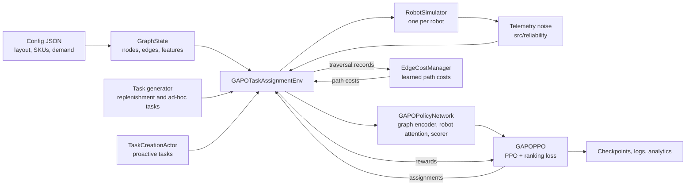

<p align="center">
  
</p>

# CareRobotics

Website: [thecarerobotics.com](https://www.thecarerobotics.com/)

CareRobotics is building the automation layer that gives hospital staff their time back. Ward nurses spend a large part of each shift searching for supplies and equipment, and missing stock delays care. CareRobotics is developing robots that restock wards, with the task-allocation software in this repository deciding which robot does which job. The company is supported by Imperial College London and UCL through the Imperial VCC Accelerator and the UCL Venture Builder. A full-size prototype is in development, and a hospital pilot is under discussion with HCA UK.

This repository holds the task-allocation and fleet orchestration software/model code for CareRobotics robots. This branch, `main`, is configured for tests in hospital environments, the end goal being a fully functional multi-robot system that can revolutionise patient care in hospitals, by saving clinical staff time previously attributed to laborious manual replenishment and other logistics tasks. The `pilot_trial` branch is configured for the inaugural pilot, aiming to replicate the replenishment logistics in a hospital in a school environment.

## Overview

A multi-agent PPO policy (GAPO) decides which robot takes each restocking task. The environment simulates ward shelves consuming stock, raises a replenishment task when a shelf falls to its reorder point, and moves robots along a graph of storage and ward nodes to pick up and deliver. Ad-hoc, returns and emergency tasks arrive alongside replenishment.

Both branches run the same learning and environment code. They differ only in the layout and demand layer: the config format and loader, the graph and task features, the demand model, and a few layout-specific rewards. See [Environments](#environments).

## Architecture



## Environments

| | Hospital (`main`, this branch) | ILC pilot (`pilot_trial`) |
| --- | --- | --- |
| Config | `configs/revised_hospital_config_v3.json` (and a reduced-consumption variant) | `configs/ilc_pilot_v1_care_robotics.json` |
| Layout | 12 nodes: 3 storage, 9 recovery wards | 3 nodes: 1 storage, 2 shelves |
| Stock | 132 SKUs (81 to 132 per node) | 4 SKUs |
| Robots | 5 by default, capacity 12 | 1, capacity 2 |
| Demand per SKU | daily mean × intraday profile × weekday × served beds × department-category multiplier | daily mean × school-period profile × weekday × node foot traffic |
| Time features | 4 shift periods, intraday and weekday weights | school periods from the config |
| Task types | replenishment, ad hoc, returns, emergency | replenishment |
| Task features | 15, including task-type flags | 10 |
| Layout-specific rewards | robot collision tracking, pickup load bonus, ad-hoc delivery bonus | restock-before-break bonus, movement-during-break penalty |

Shared by both: the GAPO policy and PPO, attention and debiasing, the learned edge-cost model, the task-creation actor, charging (robots charge at hub or storage nodes), the loggers and analytics, and telemetry noise.

## Status

| Area | State |
| --- | --- |
| Simulation training (`run_training.py`) | Working |
| Simulation deployment (`run_deployment.py`) | Working, headless or with the pygame view |
| Reliability layer | Phase 1 only: telemetry noise (`src/reliability/`) |

Simulation generates its own tasks and consumption from the config, so no training data is required. The v3 demand models are generated (per-SKU negative binomial, scaled per 10 beds), not measured.

## Setup

Requires Python 3.13. Dependencies are pinned in `requirements.txt`.

```bash
python -m venv .venv
.venv\Scripts\activate          # Windows (Linux/macOS: source .venv/bin/activate)
pip install -r requirements.txt
```

## Usage

Train in simulation:

```bash
python run_training.py --config configs/revised_hospital_config_v3.json \
    --iterations 10000 --device auto --seed 42 --output-dir outputs --exp-name hospital_sim
```

Use `configs/revised_hospital_config_v3_consumption_reduced.json` (about 35% lower demand) for easier early training.

Run a trained policy headless in simulation:

```bash
python run_deployment.py --config configs/revised_hospital_config_v3.json \
    --use-trained --checkpoint outputs/hospital_sim/checkpoints/gapo_final.pth \
    --headless --max-runtime 3600
```

Drop `--headless` for the pygame view. Run any script with `--help` for its full list of flags. Deployment on the 12-node config runs at roughly one simulated second per wall-clock second.

## Repository layout

```text
run_training.py              Simulation PPO training
run_deployment.py            Simulation inference, optional pygame view
configs/                     Hospital layout and demand configuration
src/environment/             Graph, robots, tasks and the environment
src/multi_agent_ppo/         Policy, encoders, attention, PPO, learned edge cost, task creation
src/reliability/             Sim-to-real effects (telemetry noise)
src/analytics/               Realtime analytics and metrics
src/utils/                   Logging and helpers
```

## Configuration

`configs/revised_hospital_config_v3.json` is the default. Its format (version 3.0) provides:

- `nodes` with operational locations carrying served beds and department tags
- `shelves` with per-SKU bins holding par and reorder levels
- `item_database` with a consumption model per SKU: daily mean, intraday profile and weekday multipliers
- `metadata.demand_profiles` with department-category demand multipliers

`metadata.num_robots` and `metadata.robot_max_capacity` set the fleet. When they are absent, the defaults are 5 robots with capacity 12. Older hospital formats still load, but they have no per-SKU demand models. The v2.1 file that used to be the default (`hospital_3nodes_consumables.json`) produced no consumption at all and has been removed.

## Outputs

Each run writes to `--output-dir/<exp-name>/`:

- `checkpoints/`: policy, optimiser, task-creation actor and edge-cost model, plus training metrics
- `logs/`: task, decision, ranking, SKU and robot-sample logs
- `analytics/` and `metrics_final/`: plots and metric files

Deployment runs write to `outputs/`, which is git-ignored.

## Known limitations

Integration currently works with simulation only; closing the simulation-to-real gap is a work in progress.

## Contact

For hospitals, investors and engineers, use the "Get in touch" form on [thecarerobotics.com](https://www.thecarerobotics.com/).

For questions about this code, email [nikhil.raghavan25@imperial.ac.uk](mailto:nikhil.raghavan25@imperial.ac.uk).

## Development

See the [development guide](docs/development.md) for Ruff, type checking, tests and pre-commit setup.
