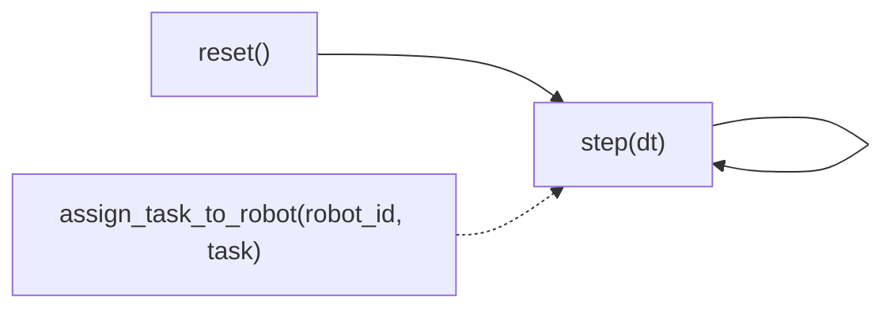

# Core interface

`GAPOTaskAssignmentEnv`, in `src/environment/gapo_env.py`, is the contract every part of this system is built against. The policy reads its observation, the trainer reads its reward, and both simulation and real deployment drive it through the same three calls.



A run calls `reset()` once, then alternates between offering pending tasks to `assign_task_to_robot` and advancing time with `step`.

## reset

`reset()` builds the graph, spawns the robots and returns the first observation, the state dictionary described below. Call it once at the start of an episode.

## assign_task_to_robot

```python
assigned_legs = env.assign_task_to_robot(robot_id, task)
```

This is how the policy or any controller hands a task to a robot. The environment checks that the robot exists, is online and does not need to charge first, then splits the task into a pickup leg and a dropoff leg and queues both on the robot.

The call returns the list of leg tasks it created. An empty list means the assignment was rejected, so callers can treat the result as falsy to detect that case.

## step

```python
state_dict, reward, done, info = env.step(dt)
```

One call to `step` advances the simulated clock by `dt` seconds. Inside, it

- consumes stock at each node and raises new replenishment tasks where a shelf has crossed its reorder point
- moves every robot along its queued path, in simulation through the robot simulator, in real deployment through the robot backend described below
- checks which legs have arrived and marks them complete
- computes the reward for the step
- feeds the step's travel data to the learned edge cost model
- builds the next observation

`done` turns true once the episode clock passes `max_episode_time`. `info` carries bookkeeping that is not part of the observation, among it the per task reward credits a training loop needs to route back to the assignment that earned them, and ambient counts such as stockouts and collisions kept purely for logging.

## The observation

Each call to `reset` or `step` returns a dictionary of plain arrays, built fresh from the current graph and robot state.

| Key | Shape | Content |
| --- | --- | --- |
| `task_features` | `[15]` on `main`, `[10]` on `pilot_trial` | Features of the first pending task, zeros if none is pending |
| `node_continuous` | `[num_nodes, N]` | Per node continuous features such as stock levels |
| `node_categorical` | `[num_nodes, 4]` | Node type, department, shift and day type as integer codes |
| `node_sku_features` | `[num_nodes, num_skus, num_categories + 10]` or `None` | Category and stock features in global SKU order |
| `node_sku_mask` | `[num_nodes, num_skus]` or `None` | Which SKUs are stocked at each node |
| `edge_features` | `[num_edges, 16]` | Per edge continuous features such as length and congestion |
| `edge_node_indices` | `[num_edges, 2]` | The two node indices each edge connects |
| `edge_index` | `[2, num_edges]` | Graph connectivity for the GNN encoder, edges listed in both directions |
| `robot_features` | `[num_robots, 19]` | Position, battery, velocity, load and availability per robot |
| `robot_positions` | `[num_robots, 2]` | Robot coordinates on their own, for convenience |
| `queue_features` | `[16]` | A summary of the pending task queue |

Here `num_edges` counts both directions of every physical edge. SKU arrays are available when the graph has category metadata.

This dictionary is the only thing the policy network sees. Nothing about whether the robots behind it are simulated or real leaks into the observation.

## Simulation versus real deployment

`GAPOTaskAssignmentEnvReal`, in `src/environment/gapo_env_real.py`, subclasses `GAPOTaskAssignmentEnv` and overrides only the methods that must differ when the robots are real.

| Method | Simulation | Real deployment |
| --- | --- | --- |
| `_update_inventory` | Depletes stock by a consumption model | Overwrites stock from the latest bridge reading |
| `_update_robot_positions` | Steps the physics style robot simulator | Polls telemetry from the robot backend |
| `_check_task_completions` | Checks node arrival | Drains completion events the backend queued |
| `_plan_path_for_robot` | Hands the path to the simulator | Sends the path to the backend |
| `_should_robot_charge` | Reads simulator battery state | Reads telemetry battery level |

Reward, the observation builder, task generation, path planning and the graph encoder are inherited unchanged, so the policy and the training loop cannot tell which subclass they are driving.

## The robot backend

`RobotBackend`, in `src/deployment/robot_backend.py`, is the abstract interface that stands between the environment and wherever robot motion actually happens.

```python
class RobotBackend(ABC):
    def get_telemetry(self, robot_id): ...
    def get_all_telemetry(self): ...
    def send_path_command(self, robot_id, path, task_id, num_items): ...
    def get_num_robots(self): ...
```

`MockRobotBackend` implements it over a list of `RobotSimulator` objects and is what simulation training and deployment use. `ROSBridgeRobotBackend` implements the same interface over a WebSocket connection to the ROS bridge, described next, and is what real deployment uses. The real environment also requires `set_graph_state`, inventory polling and the completion and failure queues provided by `ROSBridgeRobotBackend`. A custom real backend must implement these additional methods.

Start the backend with `await backend.start()` and keep its event loop running. Wait for telemetry from each robot before `env.reset()`, which raises `TelemetryUnavailableError` if a reading is missing. Finish with `await backend.stop()`.

## Next step

Continue with [ROS bridge](ros-bridge.md) for what sits on the other side of `ROSBridgeRobotBackend`.
