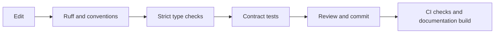

# Development

## Set up

```bash
conda activate robotics
python -m pip install -r requirements-dev.txt -r docs/requirements.txt
python -m pre_commit install
```

The hooks use the active environment. They do not create separate environments.

## Before a commit

```bash
python -m ruff check .
python -m ruff format --check .
python -m mypy
python -m pytest
python -m mkdocs build --strict
python -m pre_commit run --all-files
```

Use `python -m ruff format .` to apply formatting. Ruff checks imports and common errors throughout tracked Python code. The convention hook rejects module docstrings and multiline method docstrings.



## Type coverage

Mypy currently enforces strict checks on seven files.

| Area | Files |
| --- | --- |
| Errors | `src/exceptions.py` |
| Telemetry | `src/environment/robot/robot_telemetry.py` |
| Tasks | `src/environment/tasks/task_state.py` |
| Routes | `src/environment/graph/edge.py` |
| Metrics | `src/analytics/metrics/helpers.py` |
| Tooling | `scripts/check_conventions.py` |
| Tests | `tests/test_core_contracts.py` |

`TelemetryPayload` describes required and optional ingestion fields. Task features use NumPy arrays with an explicit element type. Spatial metrics accept a coordinate protocol.

Strict checks cover these contracts and their tests. They do not yet cover the entire environment or policy. Expand the file list in `pyproject.toml` as each module gains complete annotations. Avoid blanket error suppression.

## Next improvements

Add typed observations and backend protocols, then cover the environment and PPO code. Test assignment, inventory depletion, charging and navigation failure recovery with short seeded episodes. Add bridge message validation and replay tests.

Separate runtime dependencies from development tools and create a reproducible Conda specification. Add package metadata and move large runner scripts towards small entry points.

Require the Quality workflow for pull requests on both branches. Agree review ownership, a licence and a release process before external distribution.
