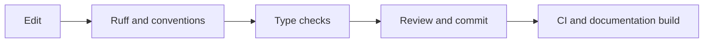

# Development

## Set up

```bash
conda activate robotics
python -m pip install -r requirements-dev.txt -r docs/requirements.txt
python -m pre_commit install
```

The hooks use the active Conda environment.

## Before a commit

```bash
python -m ruff check .
python -m ruff format --check .
python -m mypy
python -m mkdocs build --strict
python -m pre_commit run --all-files
```

Use `python -m ruff format .` to apply formatting. The convention hook rejects module docstrings and multiline method docstrings.



## Type coverage

Mypy checks function bodies throughout `src`, `scripts` and the four runners. Telemetry, tasks, routes, metric helpers and convention tooling also require complete annotations.

Typed dictionaries describe inventory, logging records and metric summaries. Nullable graph state and robot telemetry have explicit guards. Policy annotations describe the values returned to callers.

Some functions still accept untyped arguments and third party libraries may lack stubs. Extend their contracts gradually without suppressing errors across a module.

## Integration

Run the hooks in the robotics environment before sharing changes. Keep the documentation identical on both branches while preserving their deployment differences.

Require the Quality workflow for pull requests. Agree review ownership, a licence and a release process before external distribution.
