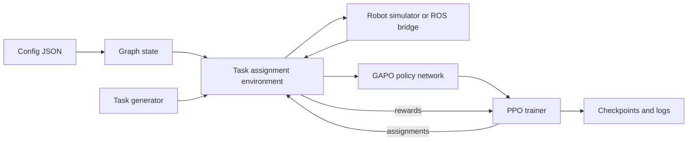

# CareRobotics

CareRobotics builds robots that restock hospital wards. This repository holds the task allocation software that decides which robot does which job. A multi agent reinforcement learning policy, GAPO, scores robots against pending tasks and assigns the best match.

The same policy and environment code runs in simulation for training and in a hospital or pilot site for real deployment. Only the layout, demand model and robot connection change between the two.

## How the pieces fit together

The config describes the hospital layout, the stock held at each location and how it depletes. The graph state turns that into nodes and edges the policy can read. The environment steps time forward, generates restocking tasks, moves robots and computes a reward. In simulation, robot movement comes from a physics style simulator. In the field, it comes from the ROS bridge talking to Nav2 on the real robot.

## Where to start

Read [Getting started](getting-started.md) to install the project and run a training or deployment script.

Read [Environments](environments.md) for the two layouts this codebase supports, a hospital ward and the ILC pilot site.

Read [Core interface](core-interface.md) for the environment contract that simulation and real deployment both implement.

Read [ROS bridge](ros-bridge.md) for how the environment talks to a physical robot over Nav2.

Read [Policy and training](policy-and-training.md) for how GAPO scores robots and how PPO trains it.

Read [Reliability](reliability.md) for the sim to real gap and what guards against it today.

Read [Development](development.md) for checks, hooks and type coverage.
