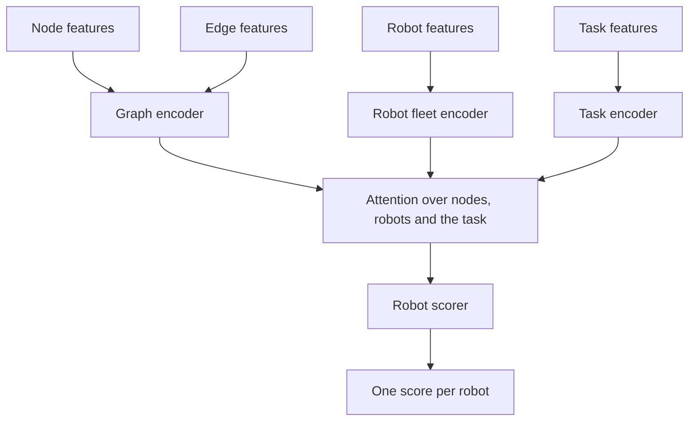
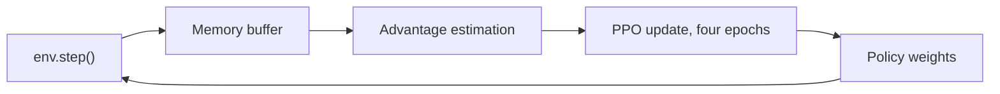

# Policy and training

GAPO, short for graph attention policy optimisation, is the neural network that scores every available robot against the most urgent pending task. The environment hands it an observation each step, described in [Core interface](core-interface.md), and it hands back a score per robot that the training loop or a deployed controller turns into an assignment.

## Scoring a robot against a task

The graph encoder is a graph attention network over the hospital layout, so a robot's score reflects the state of the whole ward, not just its own position. The robot fleet encoder lets robots attend to each other, so two robots near the same task do not both rush it. The task encoder represents the single task under consideration. All three feed a set of attention layers, in `src/multi_agent_ppo/gapo_attention.py`, that let the task attend to nodes and robots before a final robot scorer produces one number per robot.

`select_action`, on `GAPOPPO`, masks out robots that cannot currently take the task, such as offline or full robots, then samples from the resulting distribution during training or takes the top score during evaluation.

## Staying fair between robots

Several debiasing modules, in `src/multi_agent_ppo/debiasing.py`, correct tendencies a naive policy would pick up. One discourages the score from depending on the order robots happen to appear in. Another discourages a robot's score from jumping sharply between consecutive steps for no good reason. These are combined losses added during training, not separate models.

## Choosing a path

Dijkstra plans the route between two nodes, but the edge weights it uses are not fixed corridor lengths. `EdgeCostManager`, in `src/multi_agent_ppo/learned_edge_cost.py`, learns a travel time multiplier per edge from the robot's own past journeys, trained with a Gaussian negative log likelihood loss against the ratio of actual to base travel time. A risk sensitivity parameter lets Dijkstra lean away from edges the model is uncertain about, not only ones it thinks are slow.

This training is supervised and runs on its own schedule, separate from the PPO gradient described below. It consumes traversal records the environment collects every step, so it keeps learning throughout training and deployment alike.

## Creating tasks proactively

Most tasks come from a shelf crossing its reorder point, but `TaskCreationActor`, in `src/multi_agent_ppo/task_creation_actor.py`, can also raise a task ahead of that point when it judges a location is heading towards a stockout. A Bayesian factorizer estimates which locations are worth watching, and a scorer ranks the candidates it proposes.

## The training loop

Every assignment and every step reward lands in the memory buffer defined in `src/multi_agent_ppo/gapo_ppo.py`. Advantages come from generalised advantage estimation over the value head's predictions. The PPO update then runs several epochs over that memory, combining the usual clipped PPO objective with a pairwise ranking loss, so that among the robots assigned together in one step, the one with the higher advantage is pushed to score higher than the others. A small KL penalty against the previous policy keeps updates from moving too far in one step.

## Next step

Continue with [Reliability](reliability.md) for what changes when the robots on the other end of this loop are real rather than simulated.
