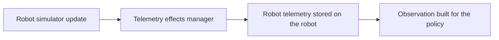

# Reliability

A policy trained against a perfect simulator will struggle the first time a real sensor drifts or a message arrives late. The reliability layer exists to close that gap by injecting the same imperfections into training that a real robot will produce in the field, so the policy learns to cope with them before it ever meets a real robot.

## Where it sits in the step cycle

Noise is injected after the simulator moves a robot and before that telemetry is stored or read for the observation. Training and simulated deployment therefore both see the same degraded signal, never a clean one.

## What is implemented today

`TelemetryEffectsManager`, in `src/reliability/telemetry_effects.py`, applies four effects to every robot's telemetry on every step.

Position drifts, modelling dead reckoning error that grows with time since the robot's last reset, at roughly 0.075 metres of standard deviation per minute elapsed.

Velocity drops out around one time in four, standing in for a command that silently failed to execute, then is reported as zero rather than left missing, since the observation has no slot for a missing value.

Heading drifts, modelling IMU error that grows with elapsed time in the same way as position.

Node and edge indices are checked against the current graph, and any index outside range is cleared rather than passed on, since a stale index that happens to look valid is worse than an honest unknown.

This is always on today. There is no configuration flag yet to disable it for a clean baseline run, so a change here affects every training run immediately.

## What is planned next

Two further phases are planned but not yet built.

A robustness phase would add occasional movement failures such as a stuck robot or wheel slip, automatic replanning when a robot stops making progress, and a confidence check before a task is assigned so the policy does not act on a position it should not yet trust.

A degradation phase would add network effects such as latency and packet loss, a physics based battery model, and a recovery path for a robot that drops off the network and reconnects later with a stale position.

Both build on the same pattern as the phase above, a manager that sits between the simulator and the observation and can be swapped out for the real backend without the policy or training loop changing at all.
