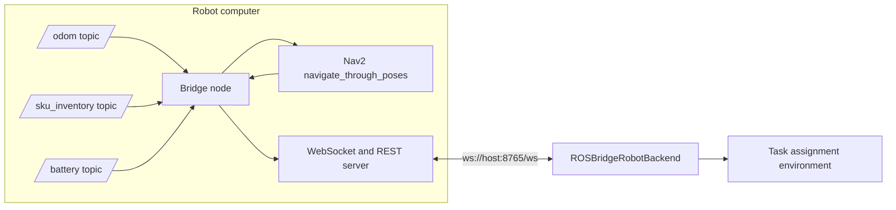
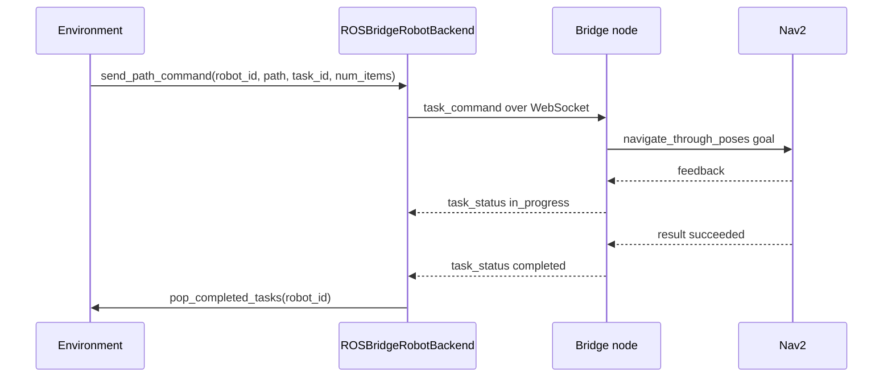

# ROS bridge

The ROS bridge is a ROS2 package that runs on the robot's onboard computer. It is the only part of this system that speaks ROS. Everything upstream, the environment, the policy and the training loop, only ever speaks the WebSocket protocol described on this page, through `ROSBridgeRobotBackend`.

The bridge package lives under `utilities/robot_ros_bridge` and is kept local to this machine. The client and real environment in `src/` are tracked. Running the bridge requires a separate ROS2 and Nav2 installation.

## What it does

The bridge node subscribes to odometry, SKU inventory and battery topics, and drives Nav2's `navigate_through_poses` action. A FastAPI server, running in the same process on a background thread, exposes that state over a WebSocket and accepts task commands back the other way.

## Node parameters

The bridge node declares its configuration as ROS2 parameters, normally supplied by a launch file.

| Parameter | Default | Purpose |
| --- | --- | --- |
| `websocket_host`, `websocket_port` | `0.0.0.0`, `8765` | Where the WebSocket and REST server listens |
| `odom_topic` | `/odom` | Source of robot position, orientation and velocity |
| `sku_inventory_topic` | `/sensor/sku_inventory` | Source of per location stock readings |
| `battery_topic` | `/sensor/battery` | Source of battery level |
| `nav2_action` | `navigate_through_poses` | The Nav2 action the bridge sends goals to |
| `nav2_timeout`, `nav2_action_server_timeout` | `300.0`, `5.0` | Declared settings. The current controller waits a fixed five seconds for the action server and does not enforce the goal timeout |
| `robot_state_publish_rate`, `system_state_publish_rate` | `10.0`, `1.0` | Broadcast rate, in hertz, for the two outgoing snapshot messages |
| `global_frame`, `base_frame` | `map`, `base_link` | Frames used when building Nav2 goals |

## The WebSocket protocol

A client connects to `ws://<host>:<port>/ws`. Commands and broadcasts use JSON with a `message_type` field. Direct command replies contain `status` and an optional `task_id` or `message`, without `message_type`.

### Messages from the bridge

`robot_state` carries position, orientation, velocity, battery level, load and the active task ID, broadcast at `robot_state_publish_rate`.

`system_state` carries the same robot state alongside every location's inventory in one snapshot, broadcast at `system_state_publish_rate`. Treat this as the primary feed. A client that only reads `system_state` still sees everything.

`task_status` carries the progress of the task currently running, with a `status` of `in_progress`, `completed`, `failed` or `canceled`, sent as Nav2 reports feedback and a final result.

`emergency_stop` carries an `active` flag. CareRobotics treats a true value as fatal and terminates its own process immediately rather than attempt to recover.

`connected` and `heartbeat` are sent once on connect and after 30 seconds without an incoming client message respectively, so a client can tell the socket is alive even when nothing else is happening.

### Messages to the bridge

`task_command` carries a `task_id`, a `robot_id`, a list of `waypoints` as `{x, y, z}` points, and task metadata. The bridge converts the waypoints to a Nav2 goal and sends it.

`task_cancel` carries a `task_id` and cancels whatever goal is active for it.

## The CareRobotics side

Two classes in `src/deployment` implement the client half of this protocol.

`RobotBridgeWebSocketClient` holds the connection itself. It parses telemetry and inventory into small dataclasses, keeps the latest reading of each available for polling, and exposes a callback per message type for code that wants to react immediately rather than poll.

`RobotBridgeTaskDispatcher` sits above the client and turns a CareRobotics `Task`, with its planned path of node indices, into the waypoint list a `task_command` message needs, resolving node indices to coordinates through the graph state.

`ROSBridgeRobotBackend`, in `src/deployment/robot_backend.py`, wraps one client and dispatcher pair per robot and is what the environment actually holds as its robot backend. It reconnects with exponential backoff if the socket drops, drains completed and failed task IDs once per environment step so the environment can react without blocking on the network, and reads the bridge URL from the `ROS_BRIDGE_URL` environment variable, falling back to `ws://localhost:8765`.

## A task from assignment to completion

## Integration limits

The current backend creates every robot client with the same URL. The local bridge controls one active Nav2 goal and does not route commands by `robot_id`. Use one robot until separate endpoints and routing are implemented.

A successful send means the socket accepted the message. Completion comes through `task_status`, and direct acceptance replies are not tracked by the client.

The client handles `emergency_stop`, but the local bridge has no producer for this message. Process termination on receipt does not itself stop the robot motors.

`/health` reports server health and `/status` returns the current robot and task state.

## Next step

Continue with [Policy and training](policy-and-training.md) for how the environment this backend feeds into chooses which robot gets which task.
